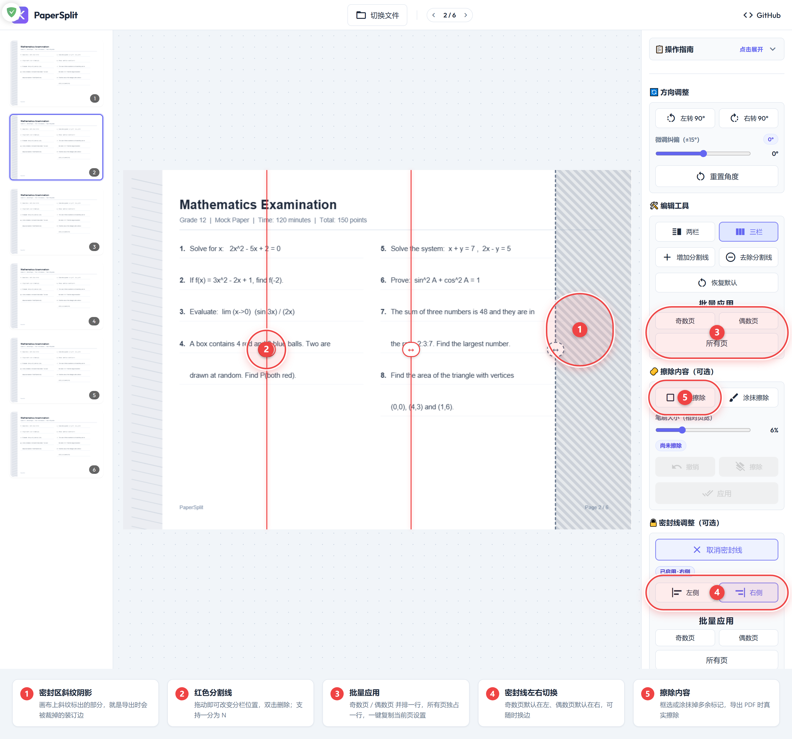

<a id="chinese"></a>

<div align="center">

  

  <h1>PaperSplit</h1>

  <p>
    <a href="https://yaoyuandejuli.github.io/PaperSplit/">
      
    </a>
    
    
    
    
  </p>

  <p><sub><i>A privacy-first A3 to A4 PDF splitter. 100% client-side processing.</i>（🚀 在线体验，无需安装，打开即用 &nbsp;·&nbsp; <i>Live demo — no install, runs in your browser</i>）</sub></p>

  <p><a href="#chinese"><b>简体中文</b></a> · <a href="#english"><b>English</b></a></p>

</div>

<p align="center">
  <a href="#-先试为快两种零门槛方式">🚀 先试为快</a> ·
  <a href="#-界面预览">🖼️ 界面预览</a> ·
  <a href="#-核心功能">✨ 核心功能</a> ·
  <a href="#-快速开始">🚀 快速开始</a> ·
  <a href="#-部署">🚢 部署</a> ·
  <a href="#faq">❓ 常见问题</a> ·
  <a href="#english">📖 English</a>
</p>

## 🚀 先试为快：两种零门槛方式

| 方式 | 操作 | 适合谁 |
|---|---|---|
| **① 在线体验（最推荐）** | 点 **[https://yaoyuandejuli.github.io/PaperSplit/](https://yaoyuandejuli.github.io/PaperSplit/)** | 只想用的人，零安装、零配置 |
| **② 本地静态托管** | 下载 ZIP → 进入 **`dist/`** → 起一个静态服务器 | 内网 / 离线环境 |

**方式② 的启动命令**

```bash
# 把 dist/ 交给任意静态服务器（推荐 npx serve）
npx serve dist
# 备选：python -m http.server -d dist
```

> ⚠️ **请勿直接双击仓库根目录的 `index.html`**：那是**源码版**页面，`src/` 里使用的是裸模块标识符（`pdfjs-dist` / `jspdf` / `material-icons`），浏览器无法解析。
> 表现是**界面能显示、但所有按钮都没反应**（控制台报模块解析错误）——这不是版本问题，也不是项目坏了。
> 正确做法：用上面**方式①**在线体验，或把 **`dist/`** 交给静态服务器，或 `npm run dev` 跑源码版。详见下方 [常见问题](#faq)。

## 📖 简介

*A privacy-first A3 to A4 PDF splitter. 100% client-side processing.*

> 正在找英文说明？跳转 **[📖 English](#english)**。

**PaperSplit** 是一个纯浏览器端运行的轻量工具，专门把 **A3 试卷 / 文档拆分成 A4**，并顺手去掉装订密封线、擦掉多余标记。文件不上传、不依赖网络，所有处理都在本机完成。

## 🖼️ 界面预览



## ✨ 核心功能

- **智能导入**：拖拽上传 PDF 或图片（JPG / PNG）。
- **多栏分割**：一页可切成 **N 栏**；「两栏 / 三栏」一键预设，「增加分割线」继续细分，「去除分割线」点击即删。
- **方向校正**：左转 / 右转 90° 摆正，再用 ±15° 滑块微调，角度实时显示，每页独立生效。
- **密封线调整**（独立分区）：奇数页默认在左、偶数页默认在右，可随时左右切换；画布上用斜纹阴影标出**导出时会被裁掉**的区域。
- **擦除内容**：框选矩形或涂抹笔刷擦除多余内容，点「应用」后画布直接显示擦除效果，导出 PDF 时真实擦除。
- **裁剪后调整**：某栏太小看不清时，放大 / 缩小 / 重置，点「应用到当前页」后比例在导出时真实生效。
- **批量应用**：「奇数页 / 偶数页」并排一行、「所有页」独占一行，一键把当前页的设置复制到同类页面；密封线分区也有同样的一组按钮，跨奇偶应用时自动镜像到另一侧，保持书页左右对称。
- **高清导出**：基于 `jsPDF` 生成标准 **A4（210×297mm）** PDF，可选等比留白 / 拉伸填满 / 等比填满三种排版方式。
- **编辑自动保存**：分割线、密封线、角度、缩放比例与擦除标记自动存在本机浏览器（localStorage），重开同一文件自动恢复，可一键清除。
- **离线可用 & 响应式**：PDF worker、图标与字体全部本地打包，断网 / 内网照常使用；PC 与手机都能操作。

## 🚀 快速开始

```bash
git clone https://github.com/yaoyuandejuli/PaperSplit.git
cd PaperSplit
npm install
npm run dev      # 启动后访问终端显示的地址（通常 http://localhost:5173）
```

**使用流程**

1. **导入**：点击「选择文件」，或把文件直接拖进工作区。
2. **调整**：拖动红色分割线确定分栏位置；用「两栏 / 三栏」「增加分割线」细分；扫描歪斜就用方向校正；多余内容用「擦除内容」；密封线在「密封线调整」里开启与换边。
3. **批量**：调好一页后，点「奇数页」「偶数页」复制到同类页面，或点「所有页」复制到整份文档。
4. **导出**：点「文件导出」下载标准 A4 的 PDF。

## 🛠️ 技术栈

原生 JavaScript（ES6 Modules）· `pdfjs-dist`（页面渲染）· `jspdf`（PDF 生成）· CSS3 · Vite

## 📂 项目结构

```
/
├── index.html          # 入口页面
├── style.css           # 全局样式
├── vite.config.js      # 构建配置
├── src/                # 源码
│   ├── main.js         # 入口与事件绑定
│   ├── state.js        # 全局状态
│   ├── dom.js          # DOM 元素引用
│   ├── file-handler.js # 文件载入与 PDF 解析
│   ├── viewer.js       # 画布渲染与翻页
│   ├── editor.js       # 分割线 / 密封线 / 批量应用
│   ├── exporter.js     # PDF 导出
│   ├── export-geometry.js # 切片范围与 A4 排版几何
│   ├── crop-adjust.js  # 裁剪后调整
│   ├── mask-editor.js  # 擦除内容（框选 + 涂抹）
│   ├── storage.js      # 编辑配置本地保存 / 恢复
│   ├── toast.js        # 轻提示
│   └── utils.js        # 旋转与擦除绘制辅助
├── public/             # 静态资源（favicon、logo）
├── screenshots/        # README 预览图
├── dist/               # 构建产物（可直接托管）
├── docs/               # 与 dist/ 相同的副本，供 GitHub Pages 使用
├── deploy/             # 可选的 Actions 自动部署模板
└── scripts/            # 一键发布脚本
```

## 🚢 部署

**线上地址**：https://yaoyuandejuli.github.io/PaperSplit/

### 一键发布

```bash
npm run build
rm -rf docs && cp -r dist docs     # 同步构建产物
npm run publish:pages               # 推到 gh-pages 分支，1-2 分钟生效
```

### 任意静态服务器

```bash
npx serve dist          # 或 python -m http.server -d dist
```

> 部分简易服务器（老版本 `python -m http.server`、部分内网部署工具）会把 `.js` 返回成 `application/octet-stream`，浏览器对 module 脚本做严格 MIME 校验。本项目已内置兼容处理（自动改用 Blob 方式加载 PDF worker），但仍**推荐用 `npx serve dist`** 启动。

### GitHub Actions 自动发布（可选）

把 `deploy/pages-workflow.yml` 复制为 `.github/workflows/deploy.yml` 并推送，之后每次改动 `docs/` 都会自动发布。

<a id="faq"></a>

## ❓ 常见问题（FAQ）

**Q：双击仓库里的 `index.html`，界面能显示但按钮点了没反应？**

这是最常见的问题。浏览器出于安全限制，**不允许 `file://` 协议加载 ES 模块**，而仓库根目录的 `index.html` 是**源码版**（`src/` 里写的是 `pdfjs-dist`、`jspdf` 这类裸模块标识符），必须经 Vite 打包才能运行。

**解决办法（任选其一）**：① 直接用[在线版本](https://yaoyuandejuli.github.io/PaperSplit/)；② 把 `dist/` 目录交给静态服务器（`npx serve dist`）；③ 克隆仓库后 `npm install && npm run dev` 跑源码版。

> 本项目已内置 `file://` 检测，会直接弹出提示层告诉你该怎么做，不用猜。

**Q：上传 PDF 提示「无法加载 PDF 文件」？**

多半是**静态服务器没有正确设置 MIME 类型**（把 `.js` 返回成 `application/octet-stream`），浏览器对 module 脚本做严格校验，PDF worker 因此加载失败。程序已内置兜底（自动改用 Blob 方式加载 worker），若仍失败请改用 `npx serve dist`。

**Q：需要联网吗？文件会上传吗？**

**都不需要**。PDF worker、图标与字体全部随应用本地打包，断网 / 内网可用；所有解析与处理都在浏览器内完成，文件不会离开你的电脑。

**Q：支持哪些文件格式？**

PDF、JPG、PNG。图片按单页处理。

**Q：编辑的内容会丢吗？**

分割线、密封线、方向角度、缩放比例与擦除标记会自动存在**本机浏览器的 localStorage**（按文件指纹区分）。重新打开同一文件会自动恢复；也可以在「文件导出」区点「清除本文件保存记录」随时清掉。

**Q：导出的 PDF 是什么规格？**

始终是**标准 A4（210×297mm）**，可选等比留白 / 拉伸填满 / 等比填满三种排版方式。

**Q：手机上能用吗？**

可以，界面为响应式设计，支持触摸拖动分割线。

## 🤝 贡献指南

欢迎提 PR 和 issue。**动手前请先看这条硬性要求**：

> ⚠️ **`src/` 目录里用的是裸模块标识符**（`import ... from 'pdfjs-dist'`、`'jspdf'`、`'material-icons'`），
> 浏览器**无法直接解析**，必须经 Vite 构建。因此：
> - **不要**把 `src/` 里的模块标识符改成相对路径，也不要直接编辑 `dist/` / `docs/` 里的构建产物（它们是生成物）；
> - 改完代码必须重新构建并同步产物，否则线上与仓库产物会不一致：
>
> ```bash
> npm install
> npm run build                    # 产出 dist/
> rm -rf docs && cp -r dist docs  # 同步到 docs/
> npm run publish:pages            # 发布到 gh-pages
> ```

其他约定：

- 代码风格沿用现有模块：原生 ES6 Modules、不引入框架，样式集中在 `style.css`；
- 改动 UI 时同步更新 `index.html` 里的**操作指南**文案；
- 提交前请本地自测一遍：导入 PDF → 分栏 → 密封线 → 擦除 → 导出 A4；
- 涉及新依赖时，请确认它能被离线打包（不要依赖 CDN）。

## 📄 开源协议

[MIT License](LICENSE) © PaperSplit

## 📅 更新日志

### 2026-10-30

- **修复部分服务器下无法加载 PDF**：PDF worker 属于 ES module，服务器 MIME 类型不对会被浏览器拒绝加载。构建产物中的 worker 统一改为 `.js`，并在运行时探测 MIME，异常时自动改用 Blob 方式加载；报错提示同时补上了原因与解决办法。
- **批量应用改为按奇偶页**：编辑工具的「批量应用」由「同类页」拆成「奇数页 / 偶数页」并排一行、「所有页」独占一行；密封线分区新增同款按钮组，跨奇偶应用时自动镜像到另一侧，目标页分割线自动钳制回保留区域。
- **密封线独立分区**：从「编辑工具」移出，成为「擦除内容」之后的新分区；画布上用斜纹阴影标出导出时会被裁掉的区域，新增左右切换与状态徽标，「恢复默认」独占一整行。
- **编辑配置自动保存**：分割线、密封线、角度、缩放比例与擦除标记存于本机 localStorage，重开同一文件自动恢复，可一键清除；仅打开文件不产生记录，读取时逐字段校验，损坏数据自动退回默认值。
- **离线可用与首屏瘦身**：PDF worker、图标与字体全部本地打包，断网 / 内网可用；`jspdf` 改为导出时按需加载，首屏体积约减半；导出显示实时进度并逐页释放画布内存。
- **代码整理与提速**：旋转控件与分割线渲染解耦，微调滑块 50ms 节流，切页作废未执行任务，清理死代码与无引用样式。

### 2026-10-29 及更早

- **多栏分割与编辑套件上线**：分割线由单条重构为数组，支持一分为 N；新增方向校正、擦除内容、裁剪后调整、统一 A4 导出，右侧面板重排为「方向调整 → 编辑工具 → 擦除内容 → 密封线 → 裁剪后调整 → 文件导出」。
- **操作指南与界面打磨**：指南改为可展开的折叠控件，术语与按钮名与界面保持一致；修复窗口缩放、快速翻页时的画布重影与密封线左右对称性问题。
- **稳定性修复**：并发渲染用令牌丢弃过期结果，窗口缩放防抖；上传不支持的文件类型会中止而不是留下「半启用」界面；密封方向改由语义决定并钳制分割点，杜绝密封区外泄与反向切片。

---

<a id="english"></a>

## 📖 English

> [⬆ 返回中文说明](#chinese) · Live demo: **https://yaoyuandejuli.github.io/PaperSplit/**

**PaperSplit** — *A privacy-first A3 to A4 PDF splitter. 100% client-side processing.*

Everything happens inside your browser: files are never uploaded, and the app keeps working offline. PaperSplit turns scanned exam papers or documents into standard A4 pages, removes the binding (seal) strip, erases stray marks, and exports a clean A4 PDF.

**Features**

- **Import** — drag in a PDF or an image (JPG / PNG).
- **Multi-column splitting** — cut one page into *N* columns: "Two Columns" / "Three Columns" presets, "Add Split Line" for even more, "Remove Split Line" by clicking a line (double-click removes it too).
- **Orientation correction** — rotate 90° left / right, then fine-tune with a ±15° slider; the angle is shown live and every page is adjusted independently.
- **Seal line panel** — odd pages default to the left, even pages to the right, and the seal can be flipped to either side at any time. The area that will be cropped is shaded on the canvas, and split lines are kept inside the surviving region.
- **Erase content** — box-select a rectangle or paint with a brush; "Apply" bakes the erasure into the page and it is really removed from the exported PDF.
- **Post-crop zoom** — enlarge, shrink or reset a column that came out too small; the ratio is applied on export.
- **Batch apply** — copy the current page's setup to all odd pages, all even pages, or every page. The seal-line panel has the same buttons, and applying across parities mirrors the seal to keep the odd-left / even-right symmetry.
- **A4 export** — standard 210 × 297 mm PDF via `jsPDF`, with equal-ratio (margins), stretch-to-fill and equal-ratio-cover fit modes; export progress is shown page by page.
- **Auto-save** — split lines, seal line, orientation, zoom ratio and erase marks are stored in your browser's `localStorage` and restored automatically when you reopen the same file.
- **Offline & responsive** — the PDF worker, icons and fonts all ship with the app; works on desktop and mobile.

**Getting started**

```bash
git clone https://github.com/yaoyuandejuli/PaperSplit.git
cd PaperSplit && npm install && npm run dev
```

Or simply try the live demo: **https://yaoyuandejuli.github.io/PaperSplit/**

> **Note** — the repository's root `index.html` is the *source* version: `src/` uses bare module specifiers, so double-clicking it shows the UI but no button responds. Serve the `dist/` folder instead (`npx serve dist`), or use the live demo.
